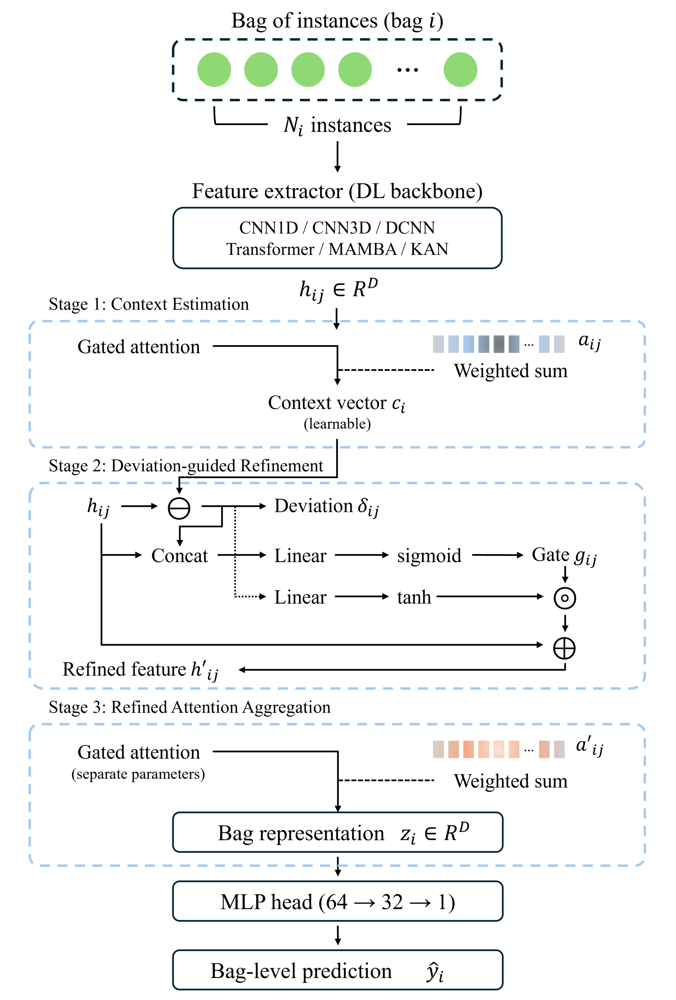
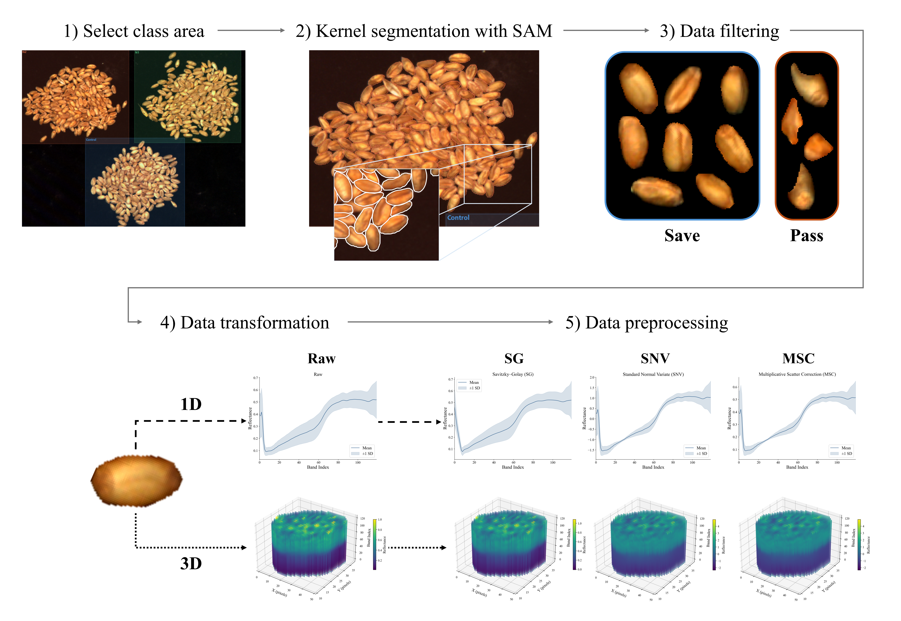
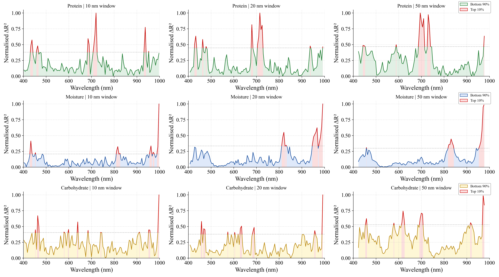
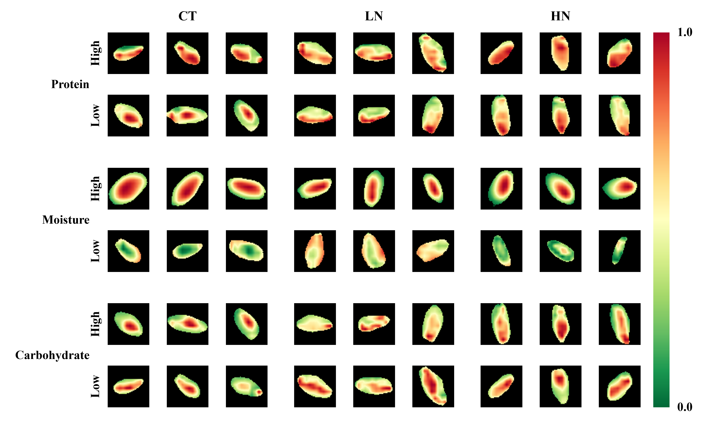

# CDG-MIL: Wheat Grain Quality Prediction from Hyperspectral Images

CDG-MIL (Contextual Deviation-Guided Multiple Instance Learning) predicts the
**protein, moisture and carbohydrate** content of a wheat sample from VNIR
hyperspectral images of its individual kernels.

Each sample is treated as a *bag* of kernels. A backbone encodes every kernel,
and the CDG head aggregates them into one prediction per sample:

1. **Context** – a gated attention pools the kernel features into a bag context `c`.
2. **Deviation gating** – each kernel's deviation `δᵢ = hᵢ − c` is gated per feature,
   `hᵢ' = hᵢ + gᵢ ⊙ tanh(W_r δᵢ)`, with `gᵢ = sigmoid(W_g [hᵢ ; δᵢ])`.
3. **Prediction** – a second gated attention (separate parameters) pools `hᵢ'`
   and an MLP regresses the target.

Both attention stages are trained end-to-end by the regression loss.

<p align="center">
  
</p>

## Repository structure

```
cdg-mil-wheat/
├── main.py                    # train / evaluate entry point
├── requirements.txt
├── code_training/             # CDG-MIL model and training code
│   ├── config.py              # paths and hyperparameters
│   ├── data.py                # bag construction, preprocessing, datasets
│   ├── models.py              # backbones + CDG head
│   ├── train.py               # training loop
│   └── evaluate.py            # R², RMSE, MAE, RPD, Bias
├── code_xai/                  # explainability
│   ├── spectral.py            # sliding-window band occlusion (1-D backbones)
│   └── spatial.py             # Grad-CAM on CNN3D kernels
├── code_sam/                  # SAM2 kernel segmentation → kernel data
│   ├── segment.py
│   └── convert_to_1d.py
├── dataset/
│   └── hyperspectral_wheat_1d.csv
└── figures/                   # README figures
```

## Data

29 wheat genotypes were grown under three nitrogen treatments (`CT` control, `LN` low
nitrogen, `HN` high nitrogen) in two field replicates, giving 174 samples. Each sample was
imaged with a VNIR hyperspectral camera (120 bands, 400–1000 nm) and split into individual
kernels. The dataset is divided by field replicate:

| Replicate | Role | Samples | Kernels (CT / LN / HN) | Kernels |
|---|---|---|---|---|
| 1 | train : validation = 8 : 2 | 87 | 1,404 / 1,290 / 1,253 | 3,947 |
| 2 | test | 87 | 1,400 / 1,348 / 1,291 | 4,039 |
| Total | | 174 | | 7,986 |

### From hyperspectral images to kernel data



Starting from reflectance-calibrated images (`R = (DN − dark) / (white − dark)`):

1. **Select class area** – one ROI is drawn for each treatment on a pseudo-RGB image
   (660, 550 and 460 nm).
2. **Kernel segmentation with SAM** – SAM 2.1 (Hiera-Large) generates kernel masks inside each ROI.
3. **Data filtering** – masks outside 300–8,000 pixels or with an aspect ratio below 0.3 are
   removed, and the remaining kernels are screened visually.
4. **Data transformation** – each kernel is stored as a 3-D cube (`50 × 50 × 120`, zero outside
   the mask) and as a 1-D spectrum (mean of the masked pixels).
5. **Data preprocessing** – Raw, SG, SNV or MSC, applied during training (`--prep`).

Steps 1–4 are implemented in `code_sam/`:

- **`segment.py`** – interactive ROI selection, SAM2 segmentation and kernel review; saves the
  cubes to `dataset/hyperspectral_wheat_3d/`. Needs [SAM2](https://github.com/facebookresearch/sam2),
  the `sam2.1_hiera_large.pt` checkpoint in `sam2_checkpoints/`, and the calibrated images with
  `metadata.json` in `dataset/hyperspectral_wheat_calibrated/`.
- **`convert_to_1d.py`** – averages the masked pixels of every cube into
  `dataset/hyperspectral_wheat_1d.csv`.

### Files

**`dataset/hyperspectral_wheat_1d.csv`** – the 1-D hyperspectral data used in this study.
One row per kernel:

| Column | |
|---|---|
| `genotype`, `replicate`, `treatment` | sample (bag) identity |
| `b000`–`b119` | mean reflectance of the kernel's pixels per band |

**`dataset/hyperspectral_wheat_3d/`** – the 3-D hyperspectral data. One `.npy` file per kernel:

| | |
|---|---|
| Shape | `50 × 50 × 120` (height × width × bands), float32 reflectance |
| Background | pixels outside the kernel mask are 0 |
| Path | `dataset/hyperspectral_wheat_3d/{CT,LN,HN}/VNIR_{genotype}-{replicate}_{treatment}_kernel_{n}.npy` |

Only the CNN3D backbone needs the cubes; the 1-D backbones run from the CSV alone.

> The 3-D data are not included in this repository because of their size (~9 GB) and are
> available from the authors upon request.

## Installation

Environment used in the study: Python 3.13.9, PyTorch 2.10.0 with CUDA 12.8 and
scikit-learn 1.7.2, trained on an NVIDIA GeForce RTX 5060 Ti.

```bash
pip install torch==2.10.0 --index-url https://download.pytorch.org/whl/cu128
pip install -r requirements.txt
```

## Usage

Train one condition with three independent repetitions and evaluate each on the test replicate:

```bash
python main.py --target Protein --backbone KAN --prep msc
```

| Option | Values |
|---|---|
| `--target` | `Protein`, `Moisture`, `Carbohydrate` |
| `--backbone` | `CNN1D`, `CNN3D`, `Transformer`, `DCNN`, `Mamba`, `KAN` |
| `--prep` | `raw`, `snv`, `msc`, `sg` |

Training settings (`code_training/config.py`): replicate 1 is split at the sample level into
training and validation sets in a fixed 8 : 2 ratio; 150 epochs, AdamW (lr 1e-4, weight decay 1e-3),
learning rate halved after 20 epochs without improvement of the training RMSE (min 1e-6),
gradient clipping 1.0, Huber loss (δ = 1), gradient accumulation over 8 bags, sub-bags of
15 kernels × 5 per epoch. The weights with the lowest validation RMSE are kept, and the test
replicate is used only for the final evaluation. The MSC reference is the mean spectrum of all
training kernels (replicate 1).

## Explainability

Both scripts take a trained checkpoint and write to `results/xai/`.

**Spectral – band occlusion** (`code_xai/spectral.py`, 1-D backbones)

```bash
python code_xai/spectral.py --checkpoint <checkpoint>.pt
```

A window of 2, 4 or 10 bands (~10, 20, 50 nm) slides one band at a time across
400–1000 nm. Each window is replaced in every test kernel by the training-set mean of the
model input, and the drop in test R² is recorded. Curves are min-max normalised and the top
10 % of windows are marked as principal bands (`--top N` changes the percentage).



**Spatial – Grad-CAM** (`code_xai/spatial.py`, CNN3D, needs the 3-D cubes)

```bash
python code_xai/spatial.py --checkpoint <checkpoint>.pt
```

Grad-CAM on the last Conv3d is computed from the bag-level prediction with the whole bag as
input, so the CDG head is fully in play. Six test samples are analysed per target – the highest
and lowest reference value within each nitrogen treatment (or the bags given with `--bags`) –
and the three kernels with the highest second-stage attention are saved as masked heat maps
together with their averaged Grad-CAM spectral profile.


